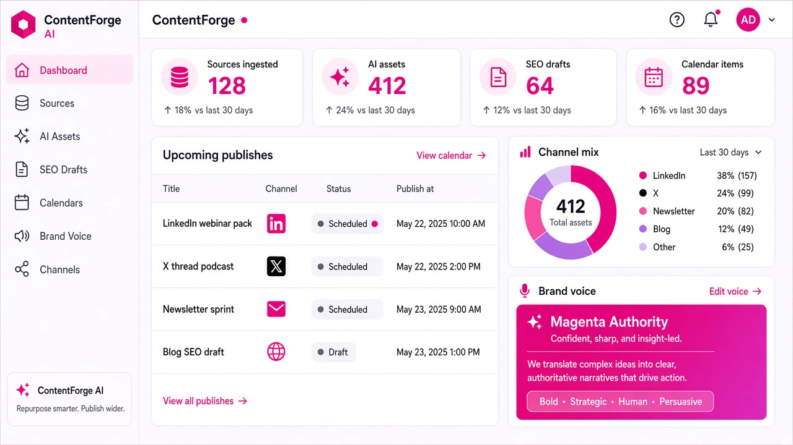

# AI Content Repurposing Tool



**SEO title:** AI Content Repurposing Tool | Webinars, Blogs & Podcasts to Multi-Channel Assets
**SEO description:** AI content repurposing tool that turns webinars, blogs, and podcasts into multi-channel assets, calendars, and SEO-ready drafts in minutes.

**Tagline:** One source → multi-channel coverage in minutes  
**Industry:** Content Marketing / Demand Gen / Media Ops  
**Accent:** `#C026D3`  
**Author:** [Imran Ahmed](https://imrandev.bd) (`me@imrandev.bd`)

---

## Why teams choose ContentForge

Content strategists burn days turning one webinar into channel-ready posts, SEO pages, and a calendar that actually ships. **AI Content Repurposing Tool (ContentForge)** is a complete Laravel + Filament business platform for ingest → AI asset packs → calendars → SEO drafts — with **every module toggleable**.

### Marketing time-saver ROI

| Manual content work | Typical weekly hours | With ContentForge |
|---|---|---|
| Webinar / podcast cleanup | 4–8 hrs | Structured ingest + transcript library |
| Channel rewriting (LI / X / email) | 6–12 hrs | AI repurpose packs per source |
| SEO outline + meta drafting | 3–6 hrs | Keyword-mapped SEO drafts |
| Calendar packing & ownership | 2–5 hrs | Campaign calendar with owners |
| Brand tone QA across writers | 2–4 hrs | Brand voice guardrails |

A mid-size B2B content team often recovers **10–20 hours per week**. At blended strategist cost, that is frequently **$1,500–$4,000+/month** in recovered capacity — before counting faster publish cadence and higher SEO coverage.

---

## Features

- **Content Ingest** — webinars, blogs, podcasts, transcripts with topics and word counts
- **Repurpose AI** — LinkedIn posts, X threads, newsletters, short scripts, carousels, excerpts
- **Content Calendars** — campaign slots, channel owners, publish status workflow
- **SEO Drafts** — meta, outlines, primary/secondary keywords, SEO scores
- **Brand Voice** — persona, tone, keywords, banned phrases, default voice
- **Channels** — LinkedIn, X, blog, newsletter, YouTube, Instagram, custom endpoints
- **Module Control Plane** — enable/disable domains from config + Filament Modules resource
- **Multi-role users** — Super Admin, Admin, Manager, Staff, Client, Demo
- **Public marketing pages** — home, features, modules, pricing, security, demo
- **Queue / jobs views** — Filament Ops tables for pending `jobs` and `failed_jobs`
- **Dockerized** — `Dockerfile` + `docker-compose.yml`
- **Packagist toolkit** — all seven `imrandevbd/*` packages declared

---

## Modules (on/off)

| Module key | Default | Purpose |
|---|---|---|
| `source_ingest` | ON | Webinar/blog/podcast ingest library |
| `multi_channel_drafts` | ON | LinkedIn, X, newsletter, YouTube, blog drafts |
| `content_calendar` | ON | Editorial publish calendar |
| `seo_packs` | ON | Keyword clusters, meta, outlines |
| `brand_voice` | ON | Tone and phrase guardrails |
| `transcript_cleanup` | ON | Normalize noisy transcripts |
| `asset_export` | ON | Unicode PDF export packs |
| `ai_hub` | ON | laravel-ai-hub generation routing |
| `catalog_scrape` | OFF | Competitor idea scrape |
| `attendance_ops` | OFF | Optional staff time-clock hub |
| `speed_optimizer` | ON | Drutogoti speed helpers |
| `slug_i18n` | ON | Universal unicode slugs |

Filament navigation hides disabled modules. Services refuse work when their module is off.

---

## Tech stack

- PHP 8.3+ / Laravel 13
- Filament 5 admin (`/admin`) — primary color `#C026D3`
- Livewire / Filament widgets
- SQLite (local default) or MySQL (Docker)
- Packages:
  - `imrandevbd/drutogoti`
  - `imrandevbd/laravel-admin-panel`
  - `imrandevbd/laravel-ai-catalog`
  - `imrandevbd/laravel-ai-hub`
  - `imrandevbd/laravel-attendance-hub`
  - `imrandevbd/laravel-unicode-pdf`
  - `imrandevbd/laravel-universal-slug`

> **Note:** Upstream Packagist builds of `drutogoti`, `laravel-admin-panel`, `laravel-attendance-hub`, and (for constraint alignment) `laravel-ai-catalog` currently need Laravel 13-compatible path shims under `packages/`. Real Packagist installs: `laravel-ai-hub`, `laravel-unicode-pdf`, `laravel-universal-slug` (catalog also bridged locally to align hub constraints).

---

## Quick start

```bash
composer install
cp .env.example .env
php artisan key:generate
touch database/database.sqlite
php artisan migrate --seed
php artisan serve
```

- Marketing site: `http://127.0.0.1:8000`
- Filament admin: `http://127.0.0.1:8000/admin`

### Demo users (password: `password`)

| Role | Email |
|---|---|
| Demo | `demo@repurposeai.test` |
| Super Admin | `superadmin@repurposeai.test` |
| Admin | `admin@repurposeai.test` |
| Manager | `manager@repurposeai.test` |
| Staff | `staff@repurposeai.test` |
| Client | `client@repurposeai.test` |

---

## Docker

```bash
docker compose up --build -d
```

App serves on port **8080**, MySQL on **3307**.

---

## Opportunities for agencies & product teams

- White-label repurposing desks for agencies managing 10+ client brands
- CRM / CMS connectors that push SEO drafts straight into WordPress or HubSpot
- Private model routing for regulated industries that cannot use public LLMs
- Performance analytics linking calendar publishes to channel engagement
- Unicode PDF export packs for multilingual asset kits

---

## Repository map

- `app/Models` — ContentSource, ChannelDraft, CalendarItem, SeoPack, BrandVoice, ModuleSetting
- `app/Services` — source ingest, draft generation, SEO packs, calendar, brand voice, transcript cleanup, asset export, module manager
- `app/Filament/Resources` — Filament CRUD for content ops
- `app/Filament/Widgets` — magenta stats + upcoming publishes
- `config/modules.php` — feature flags
- `resources/views/marketing` — public SEO pages
- `docs/screenshots/dashboard.png` — unique magenta `#C026D3` ContentForge dashboard visual

---

## 🤝 Let's Connect & Collaborate

I am open to Senior Remote Full-Stack Roles, AI Platform Architecture Contracts, and Enterprise Technical Advisory.

Timezone: UTC+6 (Dhaka / Rangpur, Bangladesh) — Flexible overlap with US, UK, and European business hours.

Delivery Mode: Async-ready, Slack, Discord, Jira, GitHub, and production-first accountability.

| Channel | Address / Handle | Quick Action |
|---|---|---|
| 🌐 Primary Portfolio | [imrandev.bd](https://imrandev.bd) | [Visit Site ↗](https://imrandev.bd) |
| 📦 Packagist Packages | [packagist.org/packages/imrandevbd/](https://packagist.org/packages/imrandevbd/) | [View Packages ↗](https://packagist.org/packages/imrandevbd/) |
| 💼 LinkedIn Profile | [linkedin.com/in/imranbru99](https://linkedin.com/in/imranbru99) | [Connect ↗](https://linkedin.com/in/imranbru99) |
| 🐙 GitHub Profile | [github.com/imranbru99](https://github.com/imranbru99) | [Follow ↗](https://github.com/imranbru99) |
| 💬 WhatsApp Direct | +880 1576-918420 | [Chat Now ↗](https://wa.me/8801576918420) |
| 📧 Direct Email | me@imrandev.bd | [Send Email ↗](mailto:me@imrandev.bd) |
| 🐦 X (Twitter) | [@imrandev_bd](https://x.com/imrandev_bd) | [Follow ↗](https://x.com/imrandev_bd) |
| 📺 YouTube Tech | [@ImranDevBD](https://youtube.com/@ImranDevBD) | [Subscribe ↗](https://youtube.com/@ImranDevBD) |


